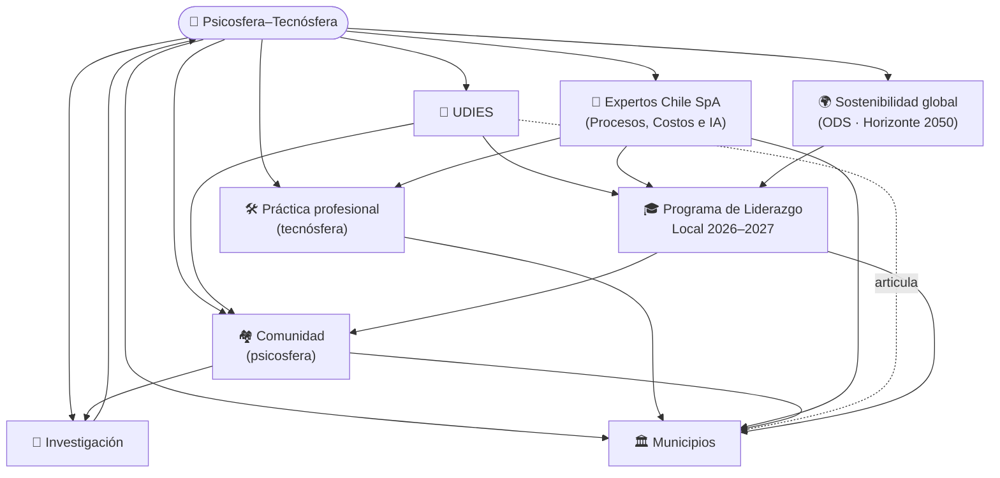

[# Gustavo Godoy

**Ph.D. (c) Gustavo Godoy** · [Perfil en Google Scholar](https://scholar.google.com/citations?user=1BDUVUYAAAAJ&hl=es)

**Pienso el territorio como la interacción entre la psicosfera y la tecnósfera.**
Todo lo que hago, como profesional, investigador, desde la consultoría tecnológica y la comunidad, se ordena bajo esa idea.

*I think of territory as the interaction between psychosphere and technosphere. Everything I do, as a professional, researcher, technology consultant and community partner, is organised under that idea.*

📍 Los Ángeles (Biobío), Chile · Cork, Ireland

---

## 🧠 La idea

Un territorio es más que lo que se ve en un mapa. Lo moldean dos cosas que se influyen todo el tiempo:

- **Tecnósfera: lo que las personas construyen.** Caminos, redes de agua y energía, edificios, máquinas, sistemas de información y espacios transformados, como plazas, canales o barrios. Es lo físico y digital, y siempre nace de una decisión humana.
- **Psicosfera: lo que las personas piensan, valoran y deciden.** Cómo se gobierna y quién decide; lo que una comunidad sabe, recuerda y es capaz de hacer en conjunto; los valores y hábitos; y qué tan justo es el reparto de riesgos y beneficios.

Ambas se apoyan en la **naturaleza** del lugar (relieve, agua, clima, sismos), que las condiciona.

Lo importante no es cada una por separado, sino **cómo interactúan**. Por ejemplo, una zona sísmica puede tener vías de evacuación y kits de emergencia (tecnósfera), pero si falta el hábito de prepararse y la confianza en las instituciones (psicosfera), esa tecnología no protege. Y al revés: una comunidad muy organizada con una infraestructura rígida tampoco puede cambiar su situación. De esa interacción depende que una ciudad u organización solo aguante una crisis y quede igual de vulnerable, o logre transformarse.

El problema es que los datos oficiales miden muy bien lo construido y casi no registran lo vivido por las personas ni los costos ocultos de las decisiones. Por eso trabajo con cuatro aliados: la **comunidad**, que conoce el territorio desde adentro; el **municipio**, que decide; **Expertos Chile SpA**, que aporta la ingeniería de procesos, gestión de costos e IA; y **UDIES**, un mecanismo que conecta a las partes en proyectos concretos.

Esta idea viene de mi trabajo doctoral sobre 80 ciudades intermedias chilenas.

🔬 El marco completo, el método y los resultados de mi investigación están en el **[sitio de investigación](https://cyberzone8.github.io/psychosphere-technosphere)**.

---

## 🌍 Sostenibilidad global, aplicada al territorio

Mi trabajo se mueve entre lo local y lo global: parte de comunas concretas y se ordena con metas de largo plazo.

- **Horizonte 2050.** Planificación estratégica sistémica, sostenible y prospectiva: se parte de la visión del territorio que se quiere y se vuelve al presente para decidir qué hacer primero. Se trabaja con escenarios (tendencial, deseable y de transformación) y con hitos a 2030, 2040 y 2050.
- **Dos anclas de largo plazo.** La Agenda 2030 y los ODS como hito intermedio, y la meta de carbono neutralidad a más tardar en 2050 que fija la Ley Marco de Cambio Climático (Ley 21.455).
- **Resiliencia y transformabilidad.** Son capacidades distintas: una comuna puede tener una sin la otra. Resiliencia es mantener lo esencial frente a una perturbación; transformabilidad es cambiar las estructuras de fondo cuando lo actual no sirve.
- **Planificación que mira a las personas.** Los planes suelen medir obras (tecnósfera) y olvidar confianza, memoria, hábitos y percepción del riesgo (psicosfera). Cerrar esa brecha evita fricción, proyectos abandonados y gasto ineficiente.
- **Territorios que se necesitan.** Simbiosis territorial entre comunidad, municipio, emprendimientos y empresas locales, traducida en trabajo e ingresos para quienes viven ahí.
- **Leyes como un solo sistema.** Planificación (PLADECO, plan regulador, PROT), participación ciudadana (Ley 20.500), cambio climático y riesgo de desastres (Leyes 21.455 y 21.364), residuos y economía circular (Ley REP 20.920), acceso a la información (Ley 20.285), datos personales (Ley 21.719) y transformación digital (Leyes 21.180 y 21.663), leídas juntas y usadas como palanca. Es información de apoyo y no reemplaza la asesoría jurídica.

### Cuatro perfiles de resiliencia y transformabilidad

La misma receta no sirve para todas las comunas. A partir de la investigación sobre 80 ciudades intermedias:

| Perfil | Qué significa | Énfasis | Caso en la investigación |
| --- | --- | --- | --- |
| **+R / +T** | Más resiliente y más transformable | Consolidar lo logrado y compartirlo con las comunas vecinas | Angol |
| **+R / −T** | Más resiliente y menos transformable | Abrir el cambio sin perder lo que identifica al territorio | Valdivia |
| **−R / +T** | Menos resiliente y más transformable | Asegurar continuidad y preparación antes de la próxima crisis | Talcahuano |
| **−R / −T** | Menos resiliente y menos transformable | Diversificar y romper la dependencia con proyectos de arranque y alianzas | Copiapó |

Es un perfil, no una nota: describe cómo funciona cada territorio y no si es mejor o peor que otro.

---

## 🗺️ Cómo se conecta todo

La comunidad aporta la mirada desde el territorio, la práctica profesional y Expertos Chile aportan el rigor técnico, la ingeniería de procesos y la tecnología, el municipio decide con ambas, UDIES articula a todos en proyectos concretos y cada proyecto devuelve aprendizaje a la investigación. El Programa de Liderazgo Local lleva esa articulación a la formación de dirigentes y equipos municipales, con horizonte 2050.

---

## 🧭 ¿Quién eres? Elige tu camino

| Si eres… | Qué encontrarás | Ir a |
| --- | --- | --- |
| **Empresa, organización o sector industrial** | Consultoría tecnológica, gestión de cambios, IA aplicada y prevención del "efecto dominó" | [🧩 Expertos Chile](https://cyberzone8.github.io/expertoschile) · [🔍 Diagnóstico 2 min](https://cyberzone8.github.io/expertoschile/diagnostico.html) |
| **Empresa, institución o proyecto que necesita ejecución en terreno** | Proyectos ambientales y de economía circular, información geoespacial, sistemas informáticos, producción, logística y comunicación, desde la Región del Biobío | [🌍 Sostenibilidad Global SpA](https://cyberzone8.github.io/sostenibilidad-global/) · [WhatsApp](https://wa.me/56985947020?text=Hola%2C%20quiero%20conversar%20con%20Sostenibilidad%20Global.) |
| **Municipio o sector público** | Mi trayectoria, mis capacidades por unidad municipal y el programa de formación para equipos municipales | [📄 CV](https://cyberzone8.github.io/cv) · [🗺️ Mapa de capacidades](https://cyberzone8.github.io/capacidades) · [🎓 Programa de liderazgo](https://cyberzone8.github.io/expertoschile/programa-liderazgo.html) |
| **Junta de vecinos u organización comunitaria** | Un trabajo que parte de lo que ustedes saben de su territorio, y un programa de 14 meses para dirigentes sociales | [🎓 Programa de liderazgo](https://cyberzone8.github.io/expertoschile/programa-liderazgo.html) · [Escríbeme](mailto:gustavogodoy.phd@gmail.com?subject=Junta%20de%20vecinos%20/%20organizaci%C3%B3n%20comunitaria) |
| **Investigación / academia** | El marco, el método y los resultados | [🔬 Psicosfera–Tecnósfera](https://cyberzone8.github.io/psychosphere-technosphere) |
| **UDIES y organizaciones aliadas** | El mecanismo que articula comunidad, investigación y Estado | 🚧 *Próximamente* · [@udies-org](https://github.com/udies-org) |
| **Educación y capacitación** | Más de 15 años de docencia universitaria y formación ejecutiva, y el programa de liderazgo local | [📄 CV](https://cyberzone8.github.io/cv#experiencia) · [🎓 Programa de liderazgo](https://cyberzone8.github.io/expertoschile/programa-liderazgo.html) |

---

## 🧩 Práctica Empresarial & Tecnológica: Expertos Chile SpA

**Expertos Chile SpA** (RUT: 77.306.348-6) es el vehículo comercial de consultoría tecnológica, ingeniería de procesos, gestión de resiliencia y capacitación en Inteligencia Artificial.

Ayudamos a directivos, empresas e instituciones a **anticipar costos ocultos, controlar cambios operativos y evitar el "efecto dominó"** en sus decisiones estratégicas. Intervenimos en tres momentos clave:

* 🟢 **ANTES (Prevenir · Ahorro hasta 75%):** Revisión de decisiones, evaluación de inversiones y detección de puntos ciegos antes de ejecutar.
* 🟡 **DURANTE (Controlar · Ahorro hasta 50%):** Control de proyectos, integración de software/IA y acompañamiento en transformaciones para evitar desviaciones.
* 🔴 **DESPUÉS (Recuperar · Ahorro hasta 25%):** Análisis de recurrencia de fallas, contención de daños y recuperación de presupuesto.

→ **Acceso al catálogo de servicios:** [Servicios de Expertos Chile](https://cyberzone8.github.io/expertoschile/productos.html)

→ **Evaluación Express:** [Diagnóstico de Costos Ocultos en 2 Minutos](https://cyberzone8.github.io/expertoschile/diagnostico.html)

---

## 🌍 Sostenibilidad Global SpA

**Sostenibilidad Global SpA** (RUT: 77.430.133-K · Qta Betania, Los Ángeles) lleva las ideas al terreno: proyectos ambientales y de economía circular, información geoespacial, sistemas informáticos, producción, logística y comunicación, desde la Región del Biobío. El sitio permite elegir un área de trabajo para ver qué hacemos en cada una.

→ **[Sitio de Sostenibilidad Global](https://cyberzone8.github.io/sostenibilidad-global/)**

### ♻️ Valorización de residuos: piloto de control predictivo

Para plantas que reciben múltiples residuos y trabajan a tope, pero aun así no ven el margen. Cada residuo llega distinto, se trata distinto y se vende distinto, pero se gestiona como si fuera uno solo. En un **piloto de 30 días** tomamos una sola línea de la planta, la mapeamos completa y mostramos qué pasará con su margen **antes** de decidir: no solo el síntoma, sino el motivo.

* **Mapa de la planta:** dónde se gana y dónde se pierde, por tipo de residuo.
* **Simulador de decisiones:** qué le pasa al margen y a la caja si cambia un precio, un proceso o un cliente.
* **Control de cambios:** alertas tempranas cuando una mejora en un punto daña otro.
* **Análisis de repetición:** por qué el mismo problema vuelve y qué lo mantiene.

**Cómo sigue:** conversación de 30 minutos → elegimos la línea del piloto → 30 días de mapeo y simulación → decisión sobre extenderlo a toda la planta. La lógica viene de mi investigación doctoral en sostenibilidad, aplicada como gerencia predictiva y contada en lenguaje de negocio.

→ **[Ver Valorización de residuos](https://cyberzone8.github.io/sostenibilidad-global/valorizacion/)** · [Hacer el diagnóstico de 2 minutos](https://cyberzone8.github.io/sostenibilidad-global/valorizacion/#diagnostico)

📱 WhatsApp [+56 9 8594 7020](https://wa.me/56985947020?text=Hola%2C%20quiero%20conversar%20con%20Sostenibilidad%20Global.) · 📧 [sostenibilidadglobalspa@gmail.com](mailto:sostenibilidadglobalspa@gmail.com)

---

## 🎓 Programa de Liderazgo Local y Desarrollo Territorial 2026–2027

Programa de **14 meses (noviembre 2026 a diciembre 2027)**, organizado por UDIES y Expertos Chile SpA, para formar dirigentes sociales, equipos municipales y líderes locales. Su idea central: pasar **de la queja a la propuesta**, con diagnósticos que terminan en proyectos concretos, financiables y que generan trabajo en el territorio, dentro de una hoja de ruta al 2050 para cada comuna.

| Fase | Período | Qué se hace | Entregable |
| --- | --- | --- | --- |
| **1. Diagnóstico sistémico y cohesión territorial** | Nov 2026 – Ene 2027 | Mapeo participativo de riesgos, puntos ciegos y capacidades locales; perfil de resiliencia y transformabilidad; línea base normativa; visión preliminar 2050 | Mapa inicial, perfil por sector o barrio, protocolo de datos y visión 2050 |
| **2. Formulación de proyectos e ingeniería social** | Feb – May 2027 | Escenarios 2050, árbol de problemas, marco lógico, indicadores, tecnología y datos para dirigentes | Dossier de anteproyectos y escenarios 2050 |
| **3. IA, pilotaje y financiamiento** | Jun – Sep 2027 | IA aplicada con reglas de uso responsable, estrategias de financiamiento y alianzas, pilotaje en terreno (SAATS) | Proyectos postulados o presentados a mesas de inversión y al municipio |
| **4. Evaluación y red de liderazgo** | Oct – Dic 2027 | Evaluación antes, durante y después; sistematización; hoja de ruta 2030–2040–2050; seminario de cierre | Informe de impacto, hoja de ruta 2050, certificación y red constituida |

**Estructura:** 4 fases y 12 módulos. **Fuentes de financiamiento que se trabajan:** FNDR 8%, FPA, SUBDERE, fondos municipales, RSE, fondos concursables y Ley de Donaciones.

**Cómo se rinde cuentas:** nueve dimensiones con indicadores verificables, entre ellas capacitación humana (mínimo 75% de asistencia), proyectos formulados con estándar FNDR o SUBDERE, empleo e ingresos frente a la línea base, perfil de resiliencia y transformabilidad al inicio y al final, planificación prospectiva 2050, uso responsable de datos e IA, y continuidad de la red.

→ **[Ver el programa completo y la hoja de ruta](https://cyberzone8.github.io/expertoschile/programa-liderazgo.html)** · [Solicitar información](https://linktr.ee/udies)

---

## 🏘️ Comunidad

Las juntas de vecinos y las organizaciones locales saben cosas que ningún registro oficial contiene: qué riesgos se sienten, qué se recuerda del lugar, en quién se confía. Trabajo con ellas mediante **SAATS (Sistema de Articulación y Aprendizaje Territorial)**, una iniciativa que conecta a la comunidad con las instituciones, la investigación y las decisiones en el territorio.

Caso piloto exploratorio: **San Carlos de Purén (Biobío)**. No se publican datos personales ni información sensible de habitantes.

---

## 🤝 UDIES

**UDIES** (*Unitas Decursui, Investigationali et Studiis Sustentabilitatis*) es un mecanismo de articulación entre la comunidad, la investigación y el Estado. Su propósito es que lo que la comunidad sabe, lo que la investigación aprende y lo que el Estado decide se conecten, para promover la sostenibilidad territorial y un desarrollo comunitario resiliente.

Lo hace de cuatro maneras:

* **Articula** a las juntas de vecinos y organizaciones comunitarias con municipios, gobiernos regionales y servicios públicos.
* **Capacita** a dirigentes comunitarios y a funcionarios públicos, entre otras vías mediante el [Programa de Liderazgo Local](https://cyberzone8.github.io/expertoschile/programa-liderazgo.html).
* **Aplica la investigación** en el territorio, con estudios, laboratorios territoriales y documentación.
* **Formula y gestiona proyectos.** El financiamiento, público o privado, es un medio y no el fin.

Cada proyecto dice qué busca cambiar y cómo se medirá, de modo que produce acción y también aprendizaje. Su forma jurídica, una fundación sin fines de lucro, está en elaboración.

---

## 🛠️ Práctica profesional

Más de 15 años en docencia universitaria, investigación, gestión de proyectos y asistencia técnica al sector público y privado. Mi CV incluye el [mapa de capacidades](https://cyberzone8.github.io/capacidades), que muestra qué puedo aportar en cada unidad del municipio y con qué evidencia.

Accesos directos: [SECPLA](https://cyberzone8.github.io/capacidades/?u=9) · [DOM](https://cyberzone8.github.io/capacidades/?u=12) · [Protección civil](https://cyberzone8.github.io/capacidades/?u=17) · [DIDECO](https://cyberzone8.github.io/capacidades/?u=19)

**Formación:** Magíster en Evaluación y Gestión de la Información Geográfica (Universidad de Jaén) · Ingeniero de Ejecución en Geomensura (Universidad de Concepción) · Doctorado en Sostenibilidad, estudios completados (UNICEPES).

---

## 📚 Publicaciones

Perfil académico completo: [Google Scholar](https://scholar.google.com/citations?user=1BDUVUYAAAAJ&hl=es)

1. **Modelo de la Isla de Calor Atmosférico y Superficial: Factores en Común y alternativas para la Mitigación de su Efecto en salud humana y medioambiente urbano.**
   [Texto en ResearchGate](https://www.researchgate.net/profile/Gustavo-Godoy-4/publication/266732360_Modelo_de_la_Isla_de_Calor_Atmosferico_y_Superficial_Factores_en_Comun_y_alternativas_para_la_Mitigacion_de_su_Efecto_en_salud_humana_y_medioambiente_urbano/links/543829c30cf2d6698bde4c58/Modelo-de-la-Isla-de-Calor-Atmosferico-y-Superficial-Factores-en-Comun-y-alternativas-para-la-Mitigacion-de-su-Efecto-en-salud-humana-y-medioambiente-urbano.pdf) · [Google Scholar](https://scholar.google.com/citations?view_op=view_citation&hl=es&user=1BDUVUYAAAAJ&citation_for_view=1BDUVUYAAAAJ:u-x6o8ySG0sC)

2. **Metabolismo urbano y entropía como catalizadores de la sostenibilidad en sistemas urbanos complejos.**
   [Artículo](https://rias.unesum.edu.ec/index.php/revista/article/view/315) · [Google Scholar](https://scholar.google.com/citations?view_op=view_citation&hl=es&user=1BDUVUYAAAAJ&citation_for_view=1BDUVUYAAAAJ:Tyk-4Ss8FVUC)

3. **Imagem aérea como representação pictórica da fotointerpretação topográfica da província de Bío-bío.**
   [Artículo en SciELO](http://www.scielo.org.co/scielo.php?pid=S2011-804X2019000100124&script=sci_abstract&tlng=pt) · [Google Scholar](https://scholar.google.com/citations?view_op=view_citation&hl=es&user=1BDUVUYAAAAJ&citation_for_view=1BDUVUYAAAAJ:qjMakFHDy7sC)

4. **Modelado de la dispersión de material particulado en la ciudad de Los Ángeles (Chile) a partir de las estufas a leña en el período de invierno usando AERMOD.**
   [Artículo en SciELO](https://www.scielo.cl/scielo.php?pid=S0718-28132016000200004&script=sci_arttext&tlng=en) · [Google Scholar](https://scholar.google.com/citations?view_op=view_citation&hl=es&user=1BDUVUYAAAAJ&citation_for_view=1BDUVUYAAAAJ:2osOgNQ5qMEC)

---

## 📂 Proyectos

| Proyecto | Qué es | Enlace |
| --- | --- | --- |
| Expertos Chile SpA | Consultoría tecnológica, gestión de decisiones e IA por sector | [Sitio](https://cyberzone8.github.io/expertoschile) · [Diagnóstico](https://cyberzone8.github.io/expertoschile/diagnostico.html) |
| Sostenibilidad Global SpA | Proyectos ambientales y de economía circular, información geoespacial, sistemas informáticos, producción, logística y comunicación | [Sitio](https://cyberzone8.github.io/sostenibilidad-global/) |
| Programa de Liderazgo Local y Desarrollo Territorial 2026–2027 | Formación de 14 meses para dirigentes y equipos municipales, con hoja de ruta al 2050 | [Programa](https://cyberzone8.github.io/expertoschile/programa-liderazgo.html) |
| Psicosfera–Tecnósfera | La idea y su investigación | [Sitio](https://cyberzone8.github.io/psychosphere-technosphere) · [Repo](https://github.com/cyberzone8/psychosphere-technosphere) |
| CV interactivo | Trayectoria y evidencia | [cyberzone8.github.io/cv](https://cyberzone8.github.io/cv) |
| Mapa de capacidades | Qué aporto en cada unidad municipal | [cyberzone8.github.io/capacidades](https://cyberzone8.github.io/capacidades) |
| SAATS | Trabajo con la comunidad | 🚧 *Próximamente* |
| UDIES | Mecanismo de articulación entre comunidad, investigación y Estado | [@udies-org](https://github.com/udies-org) |

---

## 📬 Contacto

📧 [gustavogodoy.phd@gmail.com](mailto:gustavogodoy.phd@gmail.com) · 💼 [LinkedIn](https://www.linkedin.com/in/gustavo-godoy-9b505029/) · 🎓 [Google Scholar](https://scholar.google.com/citations?user=1BDUVUYAAAAJ&hl=es)

🌍 **Sostenibilidad Global SpA:** [WhatsApp +56 9 8594 7020](https://wa.me/56985947020?text=Hola%2C%20quiero%20conversar%20con%20Sostenibilidad%20Global.) · [sostenibilidadglobalspa@gmail.com](mailto:sostenibilidadglobalspa@gmail.com)

Escríbeme indicando tu caso: [Empresa / Consultoría](mailto:gustavogodoy.phd@gmail.com?subject=Expertos%20Chile%3A%20Consulta) · [Municipio](mailto:gustavogodoy.phd@gmail.com?subject=Municipalidad%3A%20consulta) · [Investigación](mailto:gustavogodoy.phd@gmail.com?subject=Colaboraci%C3%B3n%20en%20investigaci%C3%B3n) · [Comunidad](mailto:gustavogodoy.phd@gmail.com?subject=Junta%20de%20vecinos%20/%20comunidad) · [Programa de liderazgo](mailto:gustavogodoy.phd@gmail.com?subject=Programa%20de%20Liderazgo%20Local%202026-2027) · [UDIES](mailto:gustavogodoy.phd@gmail.com?subject=Fundaci%C3%B3n%20UDIES)

---

## 🌐 English summary

I see territories as shaped by the interaction of the **psychosphere** (perception, trust, memory, participation) and the **technosphere** (infrastructure, information, technical systems). Official data capture the technosphere well and miss much of the psychosphere and hidden operational costs.

So I work with **companies & organizations** (through Expertos Chile SpA for process engineering, AI, and cost management), **communities** (who know the territory from within), **municipalities** (who decide), and **UDIES**, a mechanism that links communities, research, and the State in concrete projects. My professional practice supplies technical rigour, and every project feeds learning back into research.

My work connects the local and the global: territorial planning with a 2050 horizon, anchored in the 2030 Agenda and Chile's carbon neutrality goal, and built on a four-profile model of resilience and transformability drawn from doctoral research on 80 Chilean intermediate cities. The **Local Leadership and Territorial Development Programme 2026–2027** (14 months, 4 phases, 12 modules) trains community leaders and municipal teams to turn diagnoses into fundable projects and a 2050 roadmap for each municipality.

→ [Expertos Chile](https://cyberzone8.github.io/expertoschile) · [Research](https://cyberzone8.github.io/psychosphere-technosphere) · [CV](https://cyberzone8.github.io/cv) · [Capability map](https://cyberzone8.github.io/capacidades) · [Leadership programme](https://cyberzone8.github.io/expertoschile/programa-liderazgo.html)

---

© 2026 Derechos reservados · Gustavo Godoy Uribe, Dr.c. M.Sc. Ing. · Expertos Chile

**Cómo citar (APA 7)**

Godoy Uribe, G. (2026). *Programa de Liderazgo Local y Desarrollo Territorial 2026–2027* [Programa de formación]. UDIES; Expertos Chile SpA. https://cyberzone8.github.io/expertoschile/programa-liderazgo.html

Godoy Uribe, G. (2025). Mecanismos de sostenibilidad urbana en ciudades intermedias chilenas: Marco analítico con enfoque del realismo crítico sobre la interacción tecnosfera-psicosfera y su aplicabilidad en políticas públicas. [Tesis doctoral, Universidad Centro Panamericano de Estudios Superiores (UNICEPES)].
](https://github.com/cyberzone8)
